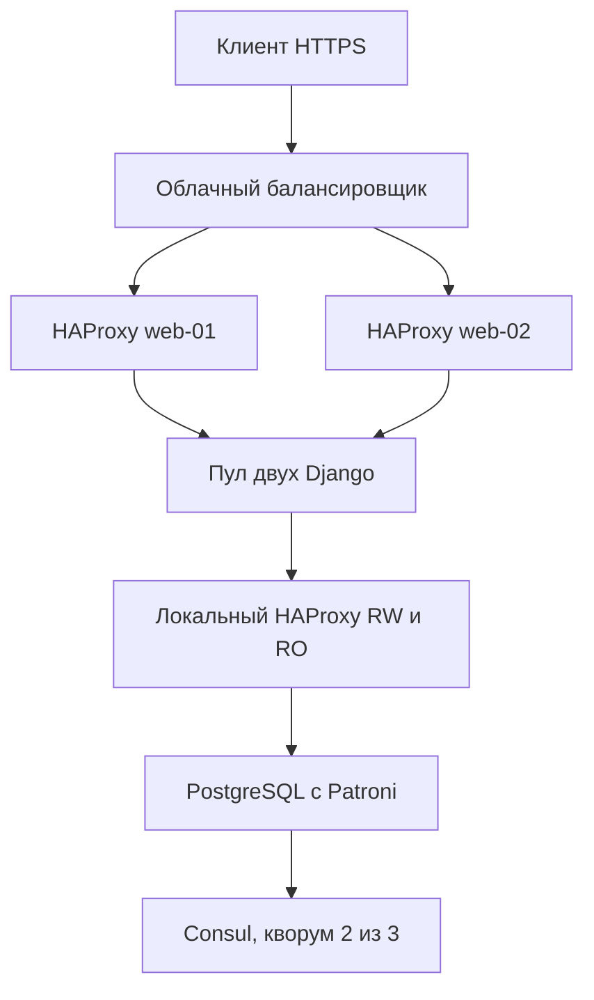

# Архитектура и план реализации

| Узел | Сервисы |
|---|---|
| `web-01` | Django/Gunicorn, HAProxy, Consul server |
| `web-02` | Django/Gunicorn, HAProxy |
| `db-01`, `db-02` | На каждой ВМ PostgreSQL, Patroni и Consul server |
| `ops-01` | ELK, Prometheus, Alertmanager, запуск скриптов резервного копирования |

Облачный балансировщик и объектное хранилище дополняют пять ВМ. Отказ `ops-01` прерывает централизованное наблюдение и создание новых копий. Веб и БД сохраняют работоспособность, уже выгруженные копии доступны.

Публичный поддомен `otus.<домен>` указывает на облачный балансировщик. Внутренние DNS-резолверы условно пересылают запросы к `discovery.<домен>` в Consul. Предусмотреть несколько доступных точек форвардинга и проверить DNS при потере `web-01`. Django публикует `/healthz/` для проверки процесса и `/readyz/` для проверки зависимостей, включая рабочий RW-путь и состояние миграций. Для веб-пула выбрать проверку, которая исключает неисправный экземпляр и сохраняет работающий путь через любой живой HAProxy.

## Этапы

| Этап | Работа | Подтверждение |
|---|---|---|
| 1. Инфраструктура | Выбрать облако, проверить зоны, лимиты и стоимость. Terraform описывает сеть, ВМ, управляемый балансировщик, хранилище и фильтрацию трафика. | Воспроизводимый plan и apply, повторный plan без дрейфа. |
| 2. Конфигурация | Salt настраивает узлы и сервисы. Подготовить управление секретами и проверить повторный прогон. | Повторная настройка сохраняет рабочее состояние. |
| 3. PostgreSQL | Поднять три сервера Consul, два PostgreSQL с Patroni, внутренний DNS и два входа HAProxy для БД. Определить удержание WAL, контроль места и процедуру пересоздания реплики. | Видны лидер Consul, primary, streaming-реплика и распределение новых RO-соединений. |
| 4. Django | Выбрать минимальный сценарий CMS, например публикацию и чтение записи. Определить контракт сессий, хранения медиа, статики, probes и минимального чтения через RO. Выпускать образ через CI, развёртывать по digest, миграции выполнять однократно отдельно от запуска приложения. | Одна запись доступна через оба веб-узла, обновление приложения воспроизводимо. |
| 5. Эксплуатация | Собирать логи с ВМ в ELK. Prometheus измеряет доступность и задержки, состояние реплики и Consul. Alertmanager сообщает об отказах. Скрипты копируют данные в объектное хранилище. | Запрос виден в логах, отказ отражается в метриках, копия успешно восстановлена в отдельную БД. |
| 6. Защита | Прогнать сценарии с контролируемой нагрузкой и сохранить результаты. | Для каждого прогона есть исходное состояние, время отказа, измерения и итог восстановления. |

Политика межсетевого экрана — запрет по умолчанию. Перед реализацией составить список разрешённых потоков между облачным балансировщиком, веб-ВМ, БД, Consul, DNS и сервером эксплуатации. SSH ограничить административным путём. Отдельно определить необходимые исходящие подключения для обновлений, DNS, времени, загрузки образов и выгрузки копий. Проверить разрешённые и запрещённые соединения.

Перед облачным развёртыванием остаётся подтвердить у преподавателя, достаточно ли HA-сервиса на облачных ВМ для формулировки «кластер виртуализации». Proxmox из ДЗ10 даёт материал для отдельного варианта, если потребуется уровень гипервизоров. Целевые значения нагрузки, RTO и допустимой потери записей остаются открытыми до согласования и базового замера.
